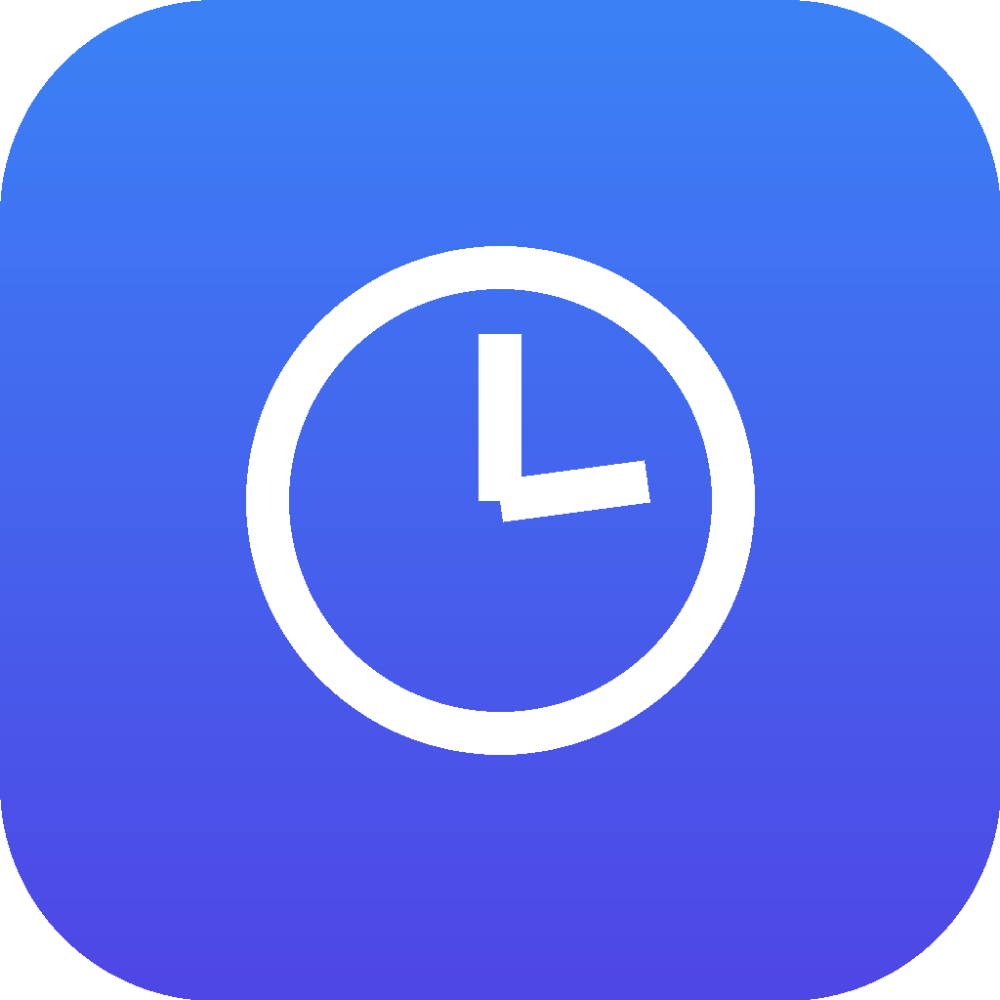

# LimitTrack

<p align="center">
  
</p>

<p align="center">
  Stop manually logging into every email account just to check if your AI coding tool's usage limit has reset.
</p>

<p align="center">
  <a href="https://github.com/rehmanoncloud9/limittrack/releases/latest"></a>
  <a href="https://github.com/rehmanoncloud9/limittrack/actions/workflows/release.yml"></a>
  
  
</p>

---

If you juggle multiple email accounts across AI coding tools like **Antigravity**, **Codex**, or **Claude Code**, LimitTrack is a small desktop app that keeps your recorded reset times together. Log a limit to estimate its reset using your configured cycle, or enter a reset time shown by the tool. Confirm availability yourself when the account is ready.

## Features

- **Multi-tool, multi-account:** track as many email accounts as you want, across as many tools as you want, each with its own reset cycle
- **Add accounts in context:** add directly inside a tool section with the tool already selected; use "Add & add another" to enter several accounts in succession
- **Floating reset overview:** keep the next estimated reset visible alongside a compact account list, with light/dark appearance and reduced-motion support
- **Tool-specific widget:** choose All tools or one tool in the widget's Show selector; your choice is remembered, and its accounts, counts, and next reset stay scoped to that tool
- **Quick limit logging:** click "Log limit" to start an estimated reset countdown, with undo for accidental changes
- **Honest status:** distinguish accounts you marked available, elapsed reset timers, active cooldowns, and accounts you have not checked
- **Search and status filters:** find accounts by tool or email and focus on available, waiting, expected-ready, or unchecked accounts
- **Manual override:** already know the exact reset time? Set it directly instead of computing it from "now"
- **Desktop notifications:** get an alert when recorded reset times pass while the app is running, with catch-up after sleep or restart and persistent deduplication
- **Light and dark appearance:** follows your system, with locally bundled styles that work offline and reduced-motion support
- **Safer local data:** validated imports with a replacement preview, atomic saves, recovery copies, and conflict detection between windows
- **System tray:** closing the window just minimizes it; LimitTrack keeps tracking behind the scenes
- **100% local:** everything is saved to a local file on your machine, nothing is sent anywhere

## Download

Grab the latest build for your OS from the [Releases page](https://github.com/rehmanoncloud9/limittrack/releases/latest):

| Platform | File |
|---|---|
| Windows | `LimitTrack-Setup-x.x.x.exe` (installer) or `LimitTrack-x.x.x-portable.exe` (no install needed) |
| macOS | `LimitTrack-x.x.x.dmg` |
| Linux | `LimitTrack-x.x.x.AppImage` or `.deb` |

> **Windows SmartScreen warning:** the app isn't code-signed (that costs money), so Windows may flag it as unrecognized. Click "More info," then "Run anyway." This is normal for small open-source apps.

## Running from source

```bash
git clone https://github.com/rehmanoncloud9/limittrack.git
cd limittrack
npm install
npm start
```

There's no build step for development; it runs straight from source.

The compiled `app.css` is included. After changing utility classes or design tokens, rebuild it with `npm run build:styles`. This development command downloads a pinned Tailwind CLI; the application itself does not need a styling CDN.

Reset cycles are user-configured estimates, not verified provider policies. Newly added accounts start as **Not checked**. A timer reaching zero means **Expected ready**, and **Mark available** records your confirmation. LimitTrack does not connect to provider accounts or measure remaining quota. Notifications require the application to be running; operating system settings can suppress them.

Local data lives in Electron's user-data directory as `limittrack-data.json`. The adjacent `.bak` file holds the previous valid store, `.before-import` preserves the state before the latest import, and damaged files are preserved with a `.corrupt-<timestamp>` suffix when recovery succeeds. Recovery copies use the internal store format; the app's exported JSON is the portable import format.

## Building installers yourself

```bash
npm run build        # build for your current OS
npm run build:win    # Windows
npm run build:mac    # macOS
npm run build:linux  # Linux
```

Installers land in `dist/`.

## Automated releases

Push a version tag and GitHub Actions handles the rest. It builds installers for Windows, macOS, and Linux in parallel, then publishes them to a GitHub Release:

```bash
git tag v1.0.0
git push --tags
```

See [`.github/workflows/release.yml`](.github/workflows/release.yml).

## Contributing

PRs and issues are welcome. See [CONTRIBUTING.md](CONTRIBUTING.md).

## License

[MIT](LICENSE). Do whatever you want with it.

## Author

Built by **Abdul Rehman**, Founder & CEO of [Stayza](https://www.stayza.pk) and a Computer Science student at NUST.

- Portfolio: [iamabdulrehman.vercel.app](https://iamabdulrehman.vercel.app)
- GitHub: [@rehmanoncloud9](https://github.com/rehmanoncloud9)
- LinkedIn: [arehman-builds](https://www.linkedin.com/in/arehman-builds)
